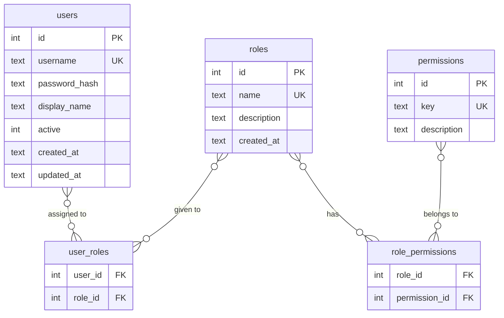
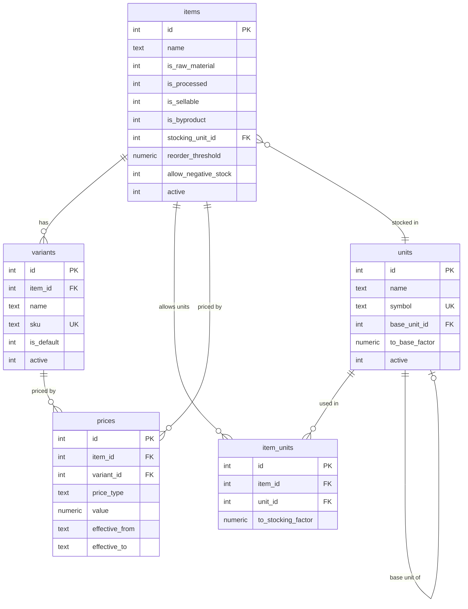
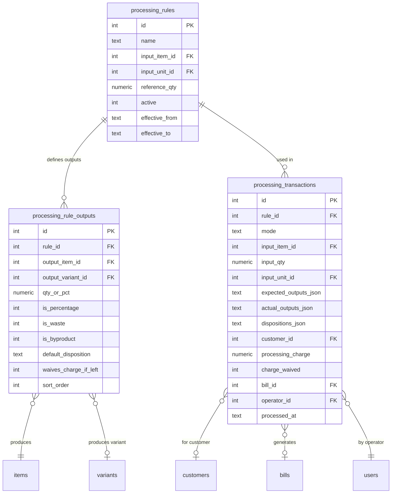
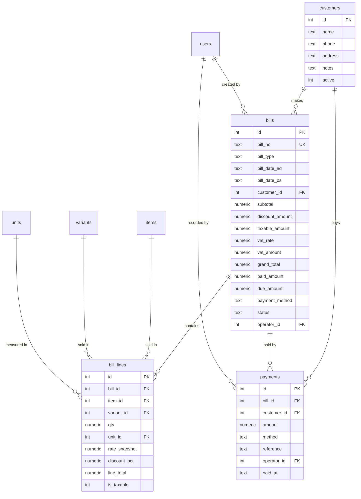
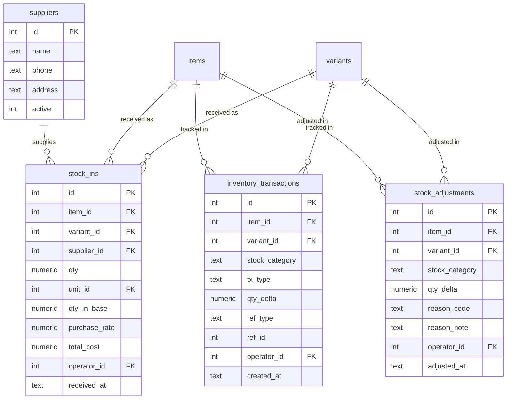
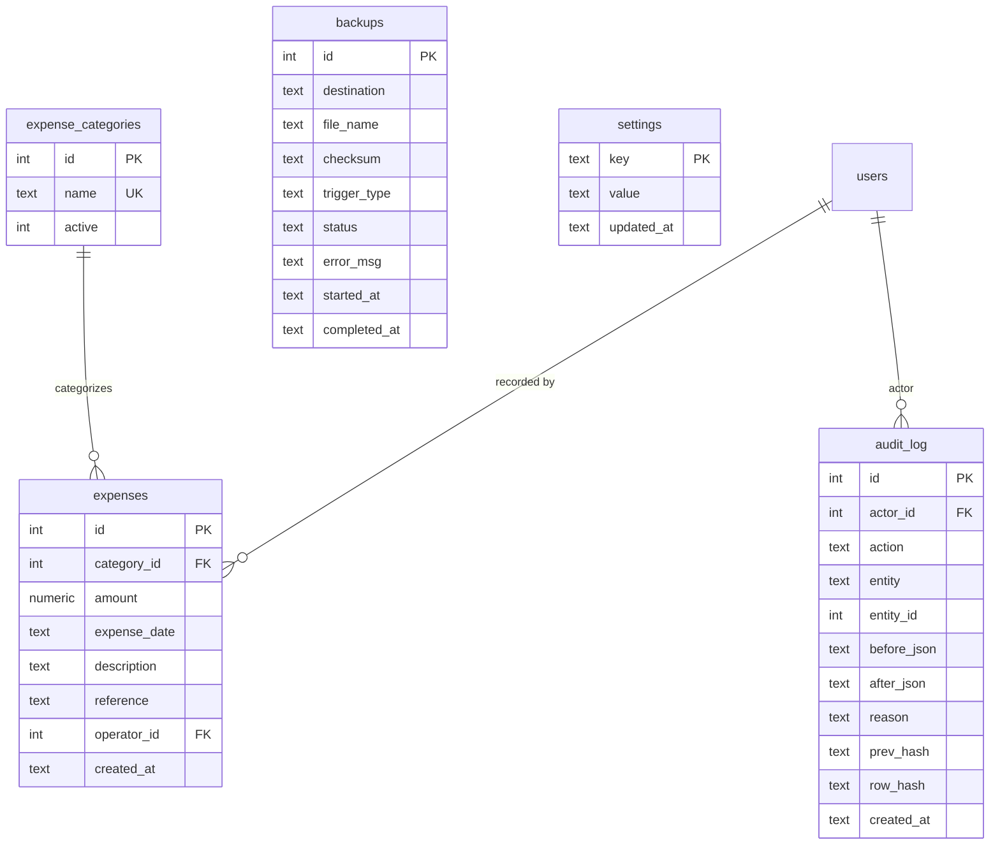

# 08 — Database Architecture

## 1. Design Principles

Before reading the diagrams, understand the three rules that govern every table relationship in this system:

**Rule 1 — The Ledger is the Truth**
`inventory_transactions` is the only source of stock levels. No table stores a running stock count. Current stock = `SUM(qty_delta)` filtered by item/variant/category. Every operation that touches physical stock writes a row here — no exceptions.

**Rule 2 — Nothing Is Deleted**
Completed records are never physically removed. Cancellations write a compensating row and update a status flag. This means every historical state of the system is reconstructible at any point in time.

**Rule 3 — Snapshots Over References for Financial Data**
`bill_lines.rate_snapshot` stores the price at transaction time. Reports and reprints read the snapshot, not the live `prices` table. Changing today's price never alters a historical bill total.

---

## 2. Table Clusters

The 26 tables are organized into seven functional clusters. Cross-cluster relationships always flow in one direction: downstream clusters reference upstream ones, never the reverse.

```
┌─────────────────────────────────────────────────────────────────────┐
│                          SYSTEM CLUSTER                              │
│              audit_log   backups   settings                          │
│     (referenced by nothing; receives writes from all clusters)       │
└─────────────────────────────────────────────────────────────────────┘
         ▲              ▲              ▲              ▲
         │              │              │              │
┌────────┴──────┐ ┌────┴──────────┐ ┌┴────────────┐ ┌┴────────────┐
│  AUTH CLUSTER │ │CATALOG CLUSTER│ │  PROCESSING  │ │   FINANCE   │
│               │ │               │ │  CLUSTER     │ │   CLUSTER   │
│  users        │ │  items        │ │              │ │             │
│  roles        │ │  variants     │ │ proc_rules   │ │ expenses    │
│  permissions  │ │  units        │ │ proc_rule_   │ │ expense_    │
│  role_perms   │ │  item_units   │ │ outputs      │ │ categories  │
│  user_roles   │ │  prices       │ │ proc_trans   │ │             │
└───────────────┘ └───────────────┘ └──────────────┘ └─────────────┘
         │                │                │
         └────────────────┼────────────────┘
                          ▼
         ┌────────────────────────────────┐
         │         SALES CLUSTER          │
         │  customers  bills  bill_lines  │
         │  payments                      │
         └────────────────────────────────┘
                          │
         ┌────────────────┼────────────────┐
         ▼                ▼                ▼
┌──────────────┐ ┌───────────────────────────┐
│  PURCHASING  │ │     INVENTORY CLUSTER      │
│  CLUSTER     │ │                            │
│  suppliers   │ │  inventory_transactions ◄─ │── (Central Ledger)
│  stock_ins   │ │  stock_adjustments         │
└──────────────┘ └───────────────────────────┘
```

**Dependency direction:** Auth ← Catalog ← Processing ← Sales ← Inventory. The Inventory cluster is written to by Sales, Processing, and Purchasing — it never writes to them.

---

## 3. Entity Relationship Diagrams

### 3.1 Auth Cluster



**Notes:**
- `users.id` is the `operator_id` / `actor_id` referenced across every other cluster — it is the identity anchor for all audit trail and transaction records.
- Phase 1 has exactly one user (Owner) with a single role that has all permissions. The tables exist and are enforced from day one so Phase 2 requires no schema change.

---

### 3.2 Catalog Cluster



**Key relationships:**
- Every `item` has at least one `variant` — the system auto-creates a `is_default = 1` variant for items that have no user-defined variants. This keeps all downstream logic (billing, inventory) uniform.
- `prices` rows are **never updated in-place**. A price change creates a new row with a new `effective_from`, setting `effective_to` on the previous row. The active price = the row with `effective_to IS NULL` (or the most recent `effective_from ≤ now`).
- `item_units` defines what units can be used when entering a transaction for that item, with the conversion factor to the stocking unit. Example: 1 Bora = 50 kg for Chamal.

---

### 3.3 Processing Cluster



**Key relationships:**
- `processing_rules` has no `input_variant_id` — input is always at the item level. Dhan is Dhan regardless of variety.
- `processing_rule_outputs.output_variant_id` is nullable — set only when the mill tracks the specific Chamal variety from in-house processing; left NULL for customer processing outputs.
- `processing_transactions.bill_id` is **always set** for `mode = 'customer'` (bill is always generated, even when `processing_charge = 0`). It is NULL only for `mode = 'in_house'`.
- `dispositions_json` records which `operator_decides` byproducts were kept by the mill vs. taken by the customer, keyed by `output_item_id`. This is what drives the charge calculation.

---

### 3.4 Sales Cluster



**Key relationships:**
- `bills.customer_id` is nullable — NULL means walk-in customer. Walk-in bills cannot have `method = 'credit'`.
- `bill_lines.rate_snapshot` is set once at bill creation and **never updated**. It stores the exact price the customer was charged, permanently decoupled from the live `prices` table.
- `payments` can reference either a specific `bill_id` (payment for one bill) or just `customer_id` (payment distributed across multiple due bills). The service layer applies distribution logic.
- `bills.paid_amount` and `bills.due_amount` are **stored denormalizations** — they are updated when payments are recorded. The canonical truth is still `SUM(payments.amount WHERE bill_id = X)`, and these fields must always match it. The service layer enforces this by updating both atomically in the same transaction.

---

### 3.5 Inventory Cluster + Purchasing



**The Central Ledger — `inventory_transactions`:**

`ref_type` + `ref_id` form a polymorphic reference pointing back to the source record that caused the stock movement:

| `ref_type`    | `ref_id` points to         | `tx_type`                         |
|---|---|---|
| `stock_in`    | `stock_ins.id`             | `stock_in`                        |
| `bill`        | `bills.id`                 | `sale` or `return`                |
| `processing`  | `processing_transactions.id` | `processed_in` or `processed_out` |
| `adjustment`  | `stock_adjustments.id`     | `adjustment`                      |
| NULL          | NULL                       | `opening`                         |

This gives you the ability to trace any stock movement back to its exact source record.

---

### 3.6 Finance + System Clusters



---

## 4. Cross-Cluster Foreign Key Map

A flat reference showing every FK across cluster boundaries:

| FK Column | Table | → References | Notes |
|---|---|---|---|
| `stocking_unit_id` | items | units | Every item has a canonical stocking unit |
| `item_id` | variants | items | Variant belongs to an item |
| `item_id` | prices | items | Price attached to item |
| `variant_id` | prices | variants | Price may be variant-specific |
| `input_item_id` | processing_rules | items | The raw material input |
| `output_item_id` | processing_rule_outputs | items | Each output product |
| `output_variant_id` | processing_rule_outputs | variants | Optional specific variant |
| `customer_id` | processing_transactions | customers | Who brought the material |
| `bill_id` | processing_transactions | bills | The generated processing bill |
| `operator_id` | processing_transactions | users | Who recorded it |
| `customer_id` | bills | customers | Nullable (walk-in = NULL) |
| `operator_id` | bills | users | Who created the bill |
| `item_id` | bill_lines | items | What was sold |
| `variant_id` | bill_lines | variants | Which variant was sold |
| `unit_id` | bill_lines | units | Unit used in this transaction |
| `bill_id` | bill_lines | bills | Which bill this line belongs to |
| `bill_id` | payments | bills | Which bill was paid |
| `customer_id` | payments | customers | Who paid |
| `operator_id` | payments | users | Who recorded payment |
| `supplier_id` | stock_ins | suppliers | Who supplied (nullable) |
| `item_id` | stock_ins | items | What was received |
| `variant_id` | stock_ins | variants | Which variant |
| `operator_id` | stock_ins | users | Who received it |
| `item_id` | inventory_transactions | items | What item moved |
| `variant_id` | inventory_transactions | variants | Which variant moved |
| `operator_id` | inventory_transactions | users | Who caused the movement |
| `item_id` | stock_adjustments | items | What was adjusted |
| `variant_id` | stock_adjustments | variants | Which variant |
| `operator_id` | stock_adjustments | users | Who adjusted |
| `category_id` | expenses | expense_categories | Expense type |
| `operator_id` | expenses | users | Who recorded |
| `actor_id` | audit_log | users | Who performed the action |

---

## 5. Data Flow — Write Sequences

For every major operation, these are the exact tables written to, in order, inside a single SQLite transaction. If any step fails, the entire operation rolls back.

### 5.1 Customer Processing — Byproduct Left (Free)

```
Trigger: Operator records Tori processing, customer leaves Pina

WRITE [1] processing_transactions
  mode = 'customer'
  input_item_id = <tori_id>
  input_qty = 20
  dispositions_json = {"<pina_item_id>": "mill_keeps"}
  processing_charge = 0
  charge_waived = 1

WRITE [2] inventory_transactions   (for each mill-retained byproduct)
  item_id = <pina_id>
  stock_category = 'byproduct'
  tx_type = 'processed_in'
  qty_delta = +12   ← estimated from rule (20 × 62/100)
  ref_type = 'processing'
  ref_id = processing_transactions.id

WRITE [3] bills
  bill_type = 'processing'
  grand_total = 0.00
  paid_amount = 0.00
  due_amount = 0.00
  status = 'active'

WRITE [4] bill_lines
  rate_snapshot = 0.00
  line_total = 0.00

WRITE [5] payments
  amount = 0.00
  method = 'byproduct_offset'

UPDATE [6] processing_transactions
  bill_id = bills.id   ← link back after bill is created

WRITE [7] audit_log
  action = 'PROCESSING_COMPLETED'

→ Print bill (work-order token handed to customer)
```

---

### 5.2 Customer Processing — Byproduct Taken (Paid)

```
Trigger: Operator records Tori processing, customer takes Pina

WRITE [1] processing_transactions
  mode = 'customer'
  dispositions_json = {"<pina_item_id>": "customer_takes"}
  processing_charge = 60.00   ← 20kg × 3.00/kg
  charge_waived = 0

WRITE [2] bills
  grand_total = 60.00

WRITE [3] bill_lines
  rate_snapshot = 3.00
  line_total = 60.00

WRITE [4] payments
  amount = 60.00 (or partial if udharo)
  method = 'cash' / 'credit' / etc.

UPDATE [5] processing_transactions
  bill_id = bills.id

WRITE [6] audit_log

→ Print bill
```

*(No inventory_transactions for Pina — customer took it; it never enters mill stock)*

---

### 5.3 In-House Processing

```
Trigger: Mill processes its own Dhan stock into Chamal

READ: Check raw_material stock for Dhan ≥ input_qty
  → SELECT SUM(qty_delta) FROM inventory_transactions
     WHERE item_id = <dhan_id> AND stock_category = 'raw_material'
  → If insufficient: ROLLBACK + user error

WRITE [1] processing_transactions
  mode = 'in_house'
  customer_id = NULL
  bill_id = NULL

WRITE [2] inventory_transactions   (deduct input)
  item_id = <dhan_id>
  stock_category = 'raw_material'
  tx_type = 'processed_out'
  qty_delta = -1000

WRITE [3] inventory_transactions   (for each non-waste output)
  item_id = <chamal_id>   | stock_category = 'finished'  | tx_type = 'processed_in' | qty_delta = +648
  item_id = <bhus_id>     | stock_category = 'byproduct' | tx_type = 'processed_in' | qty_delta = +252
  item_id = <dhuto_id>    | stock_category = 'byproduct' | tx_type = 'processed_in' | qty_delta = +79

WRITE [4] audit_log
  action = 'PROCESSING_COMPLETED'
```

*(Waste is recorded in actual_outputs_json on processing_transactions; no inventory row is written for waste)*

---

### 5.4 Create Sale Bill

```
Trigger: Operator saves a completed sale bill

READ: For each line item → check stock ≥ qty (negative stock guard)

WRITE [1] bills
  bill_no = next sequential number (computed inside transaction)
  grand_total = subtotal - discount + vat

WRITE [2] bill_lines × n   (one per line item)
  rate_snapshot = current active price (looked up before insert, stored permanently)

WRITE [3] inventory_transactions × n   (one per line item)
  tx_type = 'sale'
  qty_delta = -(qty converted to stocking unit)
  ref_type = 'bill'
  ref_id = bills.id
  stock_category = 'finished'

WRITE [4] payments
  method = 'cash' / 'bank' / 'digital' / 'credit'
  amount = paid_amount

WRITE [5] audit_log
  action = 'BILL_CREATED'

→ Print bill
```

---

### 5.5 Cancel Bill

```
Trigger: Operator cancels a saved bill

UPDATE [1] bills
  status = 'cancelled'
  cancelled_by = operator_id
  cancelled_at = now()
  cancel_reason = <reason text>

WRITE [2] inventory_transactions × n   (compensating rows — restore stock)
  tx_type = 'return'
  qty_delta = +qty   ← positive; mirrors the original sale row's negative
  ref_type = 'bill'
  ref_id = bills.id

WRITE [3] audit_log
  action = 'BILL_CANCELLED'
  before_json = original bill state
  reason = cancel_reason
```

*(Bill number is never reused. The cancelled bill remains visible in audit and cancellation reports)*

---

### 5.6 Stock In (Receive Raw Material)

```
Trigger: Operator receives material from supplier

WRITE [1] stock_ins
  supplier_id = <id or NULL>
  qty = 500
  qty_in_base = 500 × to_stocking_factor   ← unit conversion applied here

WRITE [2] inventory_transactions
  tx_type = 'stock_in'
  stock_category = 'raw_material'
  qty_delta = +500   ← qty_in_base (always in stocking unit)
  ref_type = 'stock_in'
  ref_id = stock_ins.id

WRITE [3] audit_log
  action = 'STOCK_IN_RECORDED'
```

---

### 5.7 Manual Stock Adjustment

```
Trigger: Operator corrects stock after a physical recount

WRITE [1] stock_adjustments
  qty_delta = -8   (ledger says 450, count is 442 → remove 8)
  reason_code = 'recount'
  reason_note = "Physical count 2081-05-10"

WRITE [2] inventory_transactions
  tx_type = 'adjustment'
  qty_delta = -8
  ref_type = 'adjustment'
  ref_id = stock_adjustments.id

WRITE [3] audit_log
  action = 'STOCK_ADJUSTED'
  before_json = {stock: 450}
  after_json  = {stock: 442}
  reason = reason_note
```

---

### 5.8 Collect Due Payment

```
Trigger: Customer comes in to pay outstanding bill(s)

For each bill being settled (oldest first):

  WRITE [1] payments
    bill_id = <bill_id>
    customer_id = <customer_id>
    amount = <amount applied to this bill>
    method = 'cash'

  UPDATE [2] bills
    paid_amount = paid_amount + applied_amount
    due_amount  = due_amount  - applied_amount
    payment_method = 'cash'   ← or 'mixed' if multiple methods

WRITE [3] audit_log
  action = 'PAYMENT_COLLECTED'
```

---

## 6. Read Patterns (Computed Queries)

These are never stored; always computed on demand.

### 6.1 Current Stock for One Item/Variant

```sql
SELECT
  stock_category,
  SUM(qty_delta) AS current_stock
FROM inventory_transactions
WHERE item_id = :item_id AND variant_id = :variant_id
GROUP BY stock_category;
```

Index used: `idx_inv_item_variant (item_id, variant_id, stock_category)` → fast.

---

### 6.2 Full Inventory Snapshot

```sql
SELECT
  i.name, v.name, t.stock_category,
  SUM(t.qty_delta) AS current_stock,
  u.symbol,
  i.reorder_threshold,
  CASE WHEN SUM(t.qty_delta) <= i.reorder_threshold THEN 1 ELSE 0 END AS is_low_stock
FROM inventory_transactions t
JOIN items    i ON i.id = t.item_id
JOIN variants v ON v.id = t.variant_id
JOIN units    u ON u.id = i.stocking_unit_id
WHERE i.active = 1
GROUP BY t.item_id, t.variant_id, t.stock_category
ORDER BY i.name, v.name, t.stock_category;
```

---

### 6.3 Stock as of a Historical Date

```sql
-- What was the stock on 2081-03-15?
SELECT SUM(qty_delta) AS stock_on_date
FROM inventory_transactions
WHERE item_id = :id AND variant_id = :vid
  AND stock_category = :cat
  AND created_at <= '2024-06-28';  -- AD equivalent of 2081-03-15
```

No other table needed. The ledger holds the complete history.

---

### 6.4 Inventory Report (Opening / Movements / Closing)

```sql
-- Opening stock at period start
SELECT SUM(qty_delta) AS opening
FROM inventory_transactions
WHERE item_id = :id AND stock_category = :cat
  AND created_at < :period_start;

-- Movements during period (grouped by tx_type)
SELECT tx_type, SUM(qty_delta) AS qty
FROM inventory_transactions
WHERE item_id = :id AND stock_category = :cat
  AND created_at BETWEEN :period_start AND :period_end
GROUP BY tx_type;

-- Closing = opening + SUM of movements during period
```

---

### 6.5 Customer Outstanding Balance

```sql
SELECT
  c.id, c.name,
  COALESCE(SUM(b.grand_total) FILTER (WHERE b.status = 'active'), 0) AS total_billed,
  COALESCE(SUM(p.amount), 0)                                         AS total_paid,
  COALESCE(SUM(b.due_amount) FILTER (WHERE b.status = 'active'), 0)  AS outstanding
FROM customers c
LEFT JOIN bills    b ON b.customer_id = c.id
LEFT JOIN payments p ON p.customer_id = c.id
WHERE c.id = :id
GROUP BY c.id;
```

---

### 6.6 Active Price for an Item/Variant

```sql
SELECT value
FROM prices
WHERE item_id    = :item_id
  AND (variant_id = :variant_id OR variant_id IS NULL)
  AND price_type  = :price_type
  AND effective_from <= :today
  AND (effective_to IS NULL OR effective_to > :today)
ORDER BY
  CASE WHEN variant_id IS NOT NULL THEN 0 ELSE 1 END,  -- prefer variant-specific
  effective_from DESC
LIMIT 1;
```

Index used: `idx_prices_lookup (item_id, variant_id, price_type, effective_from)` → fast.

---

## 7. Index Strategy

| Index Name | Table | Columns | Query It Serves |
|---|---|---|---|
| `idx_prices_lookup` | prices | `(item_id, variant_id, price_type, effective_from)` | Active price resolution at billing time |
| `idx_bills_date` | bills | `(bill_date_ad)` | Date-range sales reports |
| `idx_bills_customer` | bills | `(customer_id)` | Customer balance, customer history |
| `idx_bills_status` | bills | `(status)` | Active-only queries, cancellation reports |
| `idx_bill_lines_bill` | bill_lines | `(bill_id)` | Fetch all lines for a bill (reprint, display) |
| `idx_bill_lines_item` | bill_lines | `(item_id, variant_id)` | Product sales report |
| `idx_payments_bill` | payments | `(bill_id)` | Paid/due status per bill |
| `idx_payments_customer` | payments | `(customer_id)` | Customer payment history |
| `idx_inv_item_variant` | inventory_transactions | `(item_id, variant_id, stock_category)` | Current stock, inventory report |
| `idx_inv_created` | inventory_transactions | `(created_at)` | Historical stock queries, date-range reports |
| `idx_processing_date` | processing_transactions | `(processed_at)` | Processing report date filter |
| `idx_stock_ins_supplier` | stock_ins | `(supplier_id)` | Supplier purchase history |
| `idx_expenses_date` | expenses | `(expense_date)` | Expense report date filter |
| `idx_customers_phone` | customers | `(phone)` | Duplicate detection on create |
| `idx_audit_entity` | audit_log | `(entity, entity_id)` | Audit history for a specific record |

---

## 8. Constraint Enforcement Matrix

| Business Rule | Enforced At | Mechanism |
|---|---|---|
| Stock cannot go negative | Application — Domain layer | `checkStock()` called before any deduction, inside the same transaction |
| Price must be ≥ 0 | Database | `CHECK (value >= 0)` on `prices.value` |
| Bill number unique | Database | `UNIQUE` on `bills.bill_no` |
| Qty > 0 on bill lines | Database | `CHECK (qty > 0)` on `bill_lines.qty` |
| Valid stock category | Database | `CHECK` constraint on `inventory_transactions.stock_category` |
| Valid tx type | Database | `CHECK` constraint on `inventory_transactions.tx_type` |
| Valid payment method | Database | `CHECK` constraint on `payments.method` |
| Processing mode valid | Database | `CHECK (mode IN ('in_house','customer'))` |
| Audit log append-only | Application — Service layer | No `UPDATE`/`DELETE` on `audit_log` is ever called; enforced by code review + repo pattern |
| Transactions never deleted | Application — Service layer | No `DELETE` exposed on any business table; repo layer has no delete method |
| Bill line rate immutable | Application — Service layer | `rate_snapshot` is written once; no update path exists in the service layer |
| Customer required for credit | Application — Service layer | `customer_id IS NULL` check before accepting `method = 'credit'` |
| Bill always generated for customer processing | Application — Service layer | `createProcessingTransaction()` always calls `createBill()` regardless of charge |

---

## 9. Migration Strategy

Schema changes are managed as numbered SQL migration files in `electron/db/migrations/`:

```
electron/db/migrations/
├── 0001_initial_schema.sql
├── 0002_add_charge_waived_to_processing.sql
├── 0003_add_vat_fields_to_bills.sql
└── ...
```

**Rules:**
- Each migration file is append-only — never edit an existing migration.
- Migration files are run in numeric order on app startup if the DB's `PRAGMA user_version` is behind.
- The current schema version is stored in `PRAGMA user_version`.
- `better-sqlite3` applies migrations synchronously at startup; if any migration fails, the app exits with a clear error rather than running on a partially migrated schema.
- The restore validation (Backup module) checks the backup file's `user_version` against the running app's expected version before allowing a restore.

```typescript
// electron/db/index.ts

import Database from 'better-sqlite3';
import fs from 'fs';
import path from 'path';

const CURRENT_VERSION = 1;  // increment when adding a migration

export function openDatabase(dbPath: string): Database.Database {
  const db = new Database(dbPath);
  db.pragma('journal_mode = WAL');
  db.pragma('foreign_keys = ON');
  runMigrations(db);
  return db;
}

function runMigrations(db: Database.Database): void {
  const current = (db.pragma('user_version', { simple: true }) as number);
  const migrationsDir = path.join(__dirname, 'migrations');
  const files = fs.readdirSync(migrationsDir)
    .filter(f => f.endsWith('.sql'))
    .sort();

  db.transaction(() => {
    for (const file of files) {
      const version = parseInt(file.split('_')[0], 10);
      if (version > current) {
        const sql = fs.readFileSync(path.join(migrationsDir, file), 'utf8');
        db.exec(sql);
      }
    }
    db.pragma(`user_version = ${CURRENT_VERSION}`);
  })();
}
```

---

## 10. SQLite Configuration (Applied on Every Connection Open)

```sql
PRAGMA journal_mode = WAL;      -- non-blocking reads during writes; crash-safe
PRAGMA foreign_keys = ON;       -- enforce all FK constraints
PRAGMA synchronous = NORMAL;    -- safe on WAL mode; faster than FULL
PRAGMA cache_size = -32000;     -- 32 MB page cache (negative = kilobytes)
PRAGMA temp_store = MEMORY;     -- temp tables in RAM for faster sorts
PRAGMA mmap_size = 134217728;   -- 128 MB memory-mapped I/O for read performance
```

These are applied via `db.pragma()` calls immediately after the connection is opened, before any migrations run.
